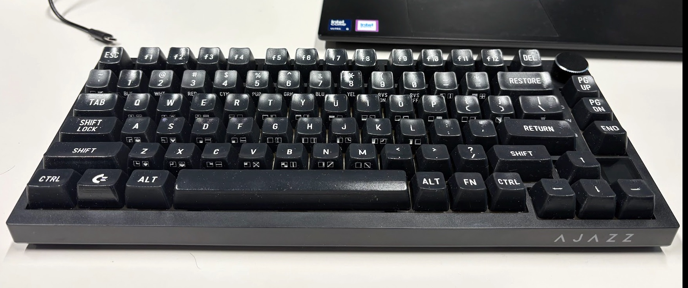
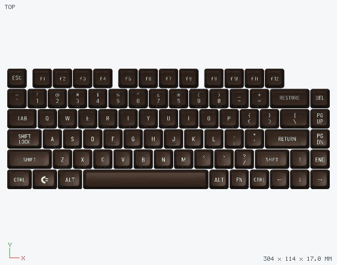
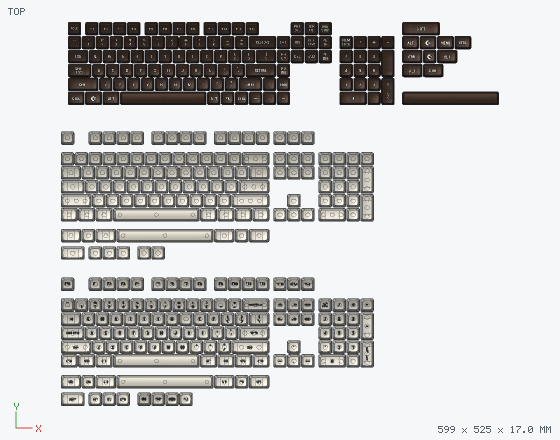
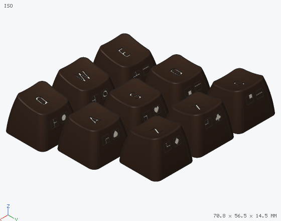

# Ajazz C64 Keycaps

Commodore 64–style keycaps for MX keyboards, made to print: dark brown SA-profile caps, cream legends in a C64 font, and the PETSCII graphics on the front of every letter key, like on the original breadbin.

*The C64 75% set on an Ajazz 75%, printed on a Formlabs Form 4 in Tough 2000 resin.*

The set started as a full C64 set for an Ajazz 75% board and grew into a universal set. The same caps come with C64 legends, plain legends or blank, for ANSI boards from 60% to full size.

## Download

Get the files from the [latest release](https://github.com/szabadkai/Ajazz-C64-Keycaps/releases/latest). Every set comes as a 3MF to slice and a STEP to open in CAD.

| Set | Files | Caps | What is in it |
|---|---|---|---|
| C64 75% | `c64-75.3mf`, `c64-75.step` | 81 | The original set: Esc and F row, RESTORE, SHIFT LOCK, RETURN, the C= key, arrows and a nav column |
| C64 add-on | `c64-addon.3mf`, `c64-addon.step` | 37 | C64-style caps for other boards: TKL nav cluster, 17-key numpad with a stacked RETURN, full-size right mods, Tsangan mods, 7u space |
| Plain | `plain.3mf`, `plain.step` | 119 | Full-size ANSI (104 caps) with standard PC legends, plus 15 extras for Tsangan, 65% and 75% |
| Blank | `blank.3mf`, `blank.step` | 117 | Full-size ANSI (104 caps) with no legends, plus 13 extras |

## Which caps to print

| Board | Plain or blank: from the full-size set | Plus |
|---|---|---|
| 60% | number row with 2u Backspace, Q row, home row, shift row (2.25u + 2.75u Shift), bottom row (1.25u × 7, 6.25u space) | Esc in place of ` if your board puts it there |
| 65% | the 60% caps without the 2.75u Shift and the right 1.25u mods; the arrows | extras: 1.75u right Shift, 1u Alt / Fn / Ctrl, Del, PgUp, PgDn, End |
| 75% | the 65% caps, Esc and F1–F12 | one more R1 key top right (Del, Ins or Home) |
| TKL | everything except the 17 numpad keys | |
| Full size | everything | |
| Tsangan bottom row | instead of the 1.25u bottom row | extras: 1.5u Ctrl × 2, 1u Win, 1.5u Alt × 2, 1u Fn, 7u space |

C64 legends: the C64 75% set is a complete 75%. For a 65%, leave out the F row. For a 60%, add the 2.75u Shift and 1.25u right mods from the add-on. For TKL and full size, add the add-on's nav cluster and numpad. The Tsangan mods and 7u space are in the add-on too.

## Printing

- **Two colours (FDM with a multi-material unit):** in the 3MF every cap is one object with its legend inlay as a second part. Open it in Bambu Studio, OrcaSlicer or PrusaSlicer and give the legends the second filament.
- **One colour:** print the caps alone and fill the engraved legends with paint, or leave them engraved. Legends are cut 0.5 mm deep.
- **Resin:** print each cap with its open bottom toward the platform, tilted 30–45°, with supports only on the skirt rim and inside, so the tops and sides stay clean. The set in the photo was printed on a Form 4 in Tough 2000.
- **Stabilizers:** every cap 2u and wider has Cherry-style stabilizer stems, 23.8 mm apart on 2u–2.75u, 100 mm on 6.25u and 114.3 mm on 7u. The numpad + and Enter are 2u caps turned upright for vertical stabilizers.
- Print one cap and try it on your switches first: how tight the stem fits depends on your printer and material.

## Details

- SA profile, sculpted rows R1 (F and number rows), R2, R3 and R4; 19.05 mm key pitch; MX cross stems.
- Legends in the [C64 Keyboard font](https://github.com/szabadkai/c64-keyboard-font). Each letter key carries its two PETSCII graphics on the front: the Commodore-key graphic on the left, the Shift graphic on the right.
- Colours in the files: C64 caps `#3b2a20` with `#f0ead6` legends; plain caps `#d9d4c7` with `#2a2a2a` legends.

## License

© 2026 Levente Szabadkai. The keycap designs, the release files and the pictures are licensed under [CC BY-NC-SA 4.0](https://creativecommons.org/licenses/by-nc-sa/4.0/): you can share and remix them if you credit this project, don't use them commercially, and share what you make under the same license. See [LICENSE](LICENSE).

**The Commodore logo is not covered by this license.** It appears on the C= keys (Win in the C64 75% set; right Win and Tsangan Win in the add-on) and in the pictures that show them. It is a trademark of its owner, and this license grants no rights to it. This is an unofficial fan project, not affiliated with or endorsed by Commodore or Ajazz. Commodore, Commodore 64 and C64 are trademarks of their owners.
